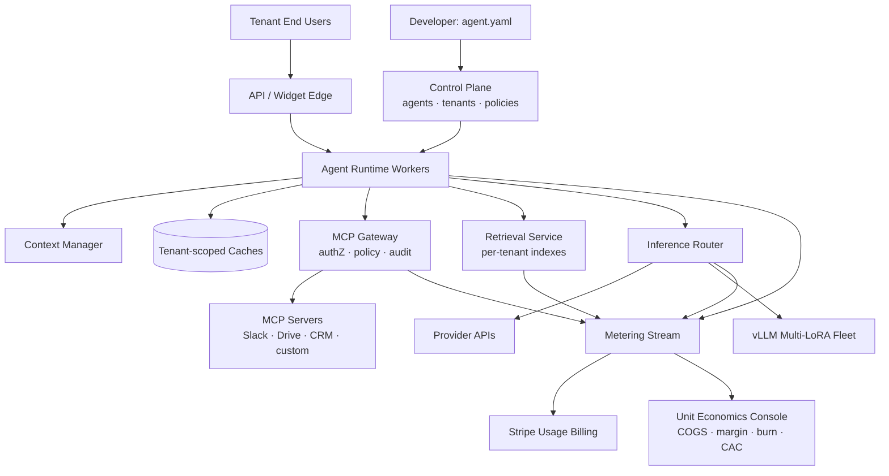

# AgentMesh Cloud: System Architecture

> A multi-tenant platform for deploying AI agents: an MCP tool gateway, per-tenant LoRA and RAG, shared caches and built-in usage billing with unit economics.
>
> **Concepts:** `MCP`, `LLMs`, `RAG`, `LoRA`, `Caches`, `Context Window`, `Burn Rate`, `CAC`

## 1. High-Level View

Control plane (agents, tenants, policies, billing) and data plane (agent runtime workers, MCP gateway, retrieval service, inference via provider APIs or a shared vLLM multi-LoRA fleet, caches). A metering pipeline streams events to billing and analytics.

## 2. Components

| Component | Responsibility |
|---|---|
| Control plane | CRUD for agents, tenants, secrets, policies; deploy pipeline. |
| Agent runtime | Durable execution (Temporal) of tool-use loops; checkpointing; approvals. |
| MCP gateway | Connects to MCP servers per tenant; injects tenant credentials; enforces policy; audits. |
| Retrieval service | Per-tenant namespaces in vector DB; ACL filtering. |
| Inference router | Chooses provider or vLLM; applies tenant adapter; handles fallbacks. |
| Cache service | Semantic + exact caches with tenant scope; prompt-prefix layout. |
| Metering | Kafka events → ClickHouse → billing + analytics. |
| Unit-economics console | Joins COGS with Stripe revenue and S&M spend. |

## 3. Request / Data Flow

1. End user message → edge authenticates tenant + user.
2. Runtime loads agent spec; context manager packs memory + instructions.
3. Cache check (tenant scope); miss → model call via router (tenant adapter if configured).
4. Model requests tool → MCP gateway checks policy → calls MCP server with tenant credentials → audited.
5. RAG tool retrieves from tenant namespace with user ACLs.
6. Every step emits metering events → billing + margins.

## 4. Data Stores

| Store | Holds | Why |
|---|---|---|
| Postgres (RLS) | Tenants, agents, policies, audit | Isolation via row-level security. |
| Qdrant / pgvector (per-tenant collections) | Knowledge | Namespace isolation. |
| Redis | Caches, rate limits | Speed. |
| Kafka + ClickHouse | Metering events | Throughput + analytics. |
| S3 | Adapters, documents | Blob storage. |
| Vault/KMS | Tenant secrets and OAuth tokens | Security. |

## 5. Deployment Topology

- Kubernetes, multi-region (EU/US) with tenant pinning.
- GPU node pool for vLLM fleet; CPU pools for runtime and gateway.

## 6. Scaling Strategy

- Runtime workers scale on queue depth; gateway stateless.
- Consistent-hash tenants to vLLM replicas for adapter cache locality.
- Per-tenant quotas + fair scheduling.

## 7. Security & Privacy

- Tenant id in every key, query and cache scope; automated isolation test suite (cross-tenant probes).
- MCP servers run sandboxed (gVisor) with egress allowlists.
- Sensitive tools require approval; full audit trail.
- Secrets never enter model context.

## 8. Observability

- Per-tenant SLOs, agent step traces (OpenTelemetry), cache hit rates, tool error rates, margin alerts.

## 9. Failure Modes

| Failure | Detection | Response |
|---|---|---|
| MCP server down | Health checks | Tool returns structured unavailable error; agent adapts. |
| Provider outage | Error rate | Router fails over to alternate model. |
| Tenant exceeds quota | Meter | Soft limit warning → hard limit 429 → upsell prompt. |
